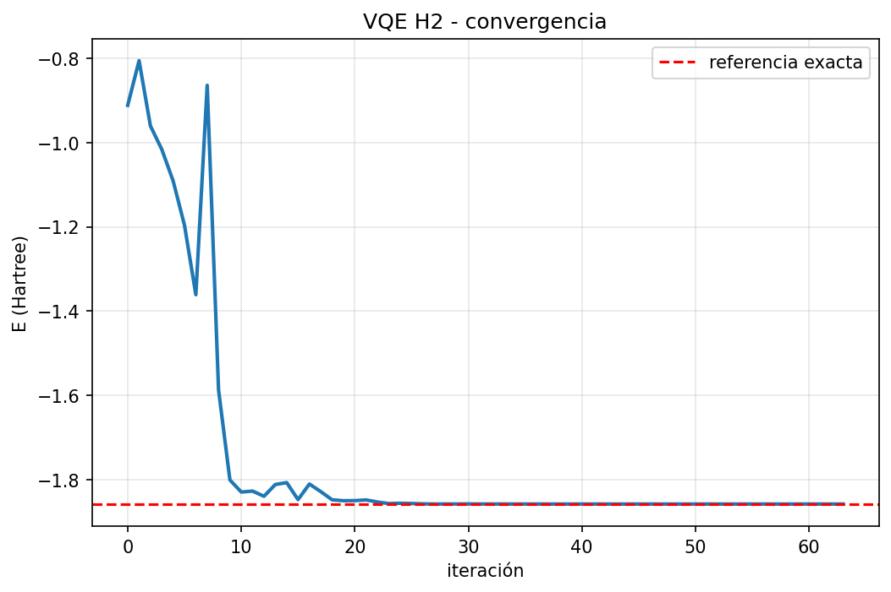

# Quantum Playground

Eight quantum computing demos in Qiskit, each producing its own figures (circuits, measurement histograms, Bloch spheres, Q-spheres, density matrices) so the result of every algorithm can be checked visually.



## Results

Sampling demos run on the Aer simulator with 4096 shots; VQE uses exact statevector expectation values.

| Demo | Result |
|---|---|
| Grover search (4 qubits, 16 states) | Marked state `1010` found with about 96% probability after 3 iterations |
| VQE for the H2 molecule | Ground-state energy -1.857275 Ha, matching exact diagonalization of the 2-qubit Hamiltonian (error below 10^-5 Ha), 64 COBYLA evaluations |
| Deutsch-Jozsa | Constant vs. balanced oracle separated with a single query |
| Bell states | Only correlated outcomes (`00`/`11` or `01`/`10`), about 50/50 |
| GHZ (5 qubits) | Only `00000` and `11111` (2078 / 2018 shots) |
| Quantum teleportation | Bob's qubit measured as 1 in 23.8% of shots vs. 25% expected for the input state Ry(π/3) |
| QFT | Output state shown as Q-sphere and density matrix |
| Bloch gallery | Effect of H, X, Y, Z, S, T, Rx, Ry on a single qubit |

## Run it

Python 3.10+.

```sh
python3 -m venv .venv && source .venv/bin/activate
pip install -r requirements.txt
cd src
python main.py        # all demos, figures written to images/
python grover.py      # or a single demo
```

Notes on how each algorithm is built and how to read its figures: [docs/NOTES.md](docs/NOTES.md).

There is also a notebook in `notebooks/quantum_playground.ipynb` and a static results page in `dashboard.html`.

## Layout

```
src/        one file per algorithm, plus utils.py (plotting helpers) and main.py
notebooks/  interactive version
images/     generated figures
```

Code comments are in Spanish.

## References

- M. Nielsen and I. Chuang, *Quantum Computation and Quantum Information*.
- [IBM Quantum Learning](https://learning.quantum.ibm.com/)

MIT License.
